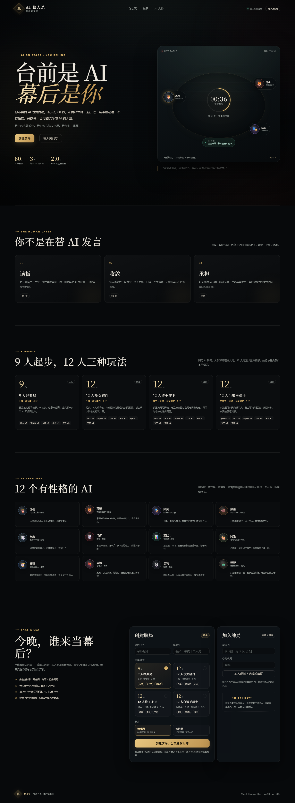
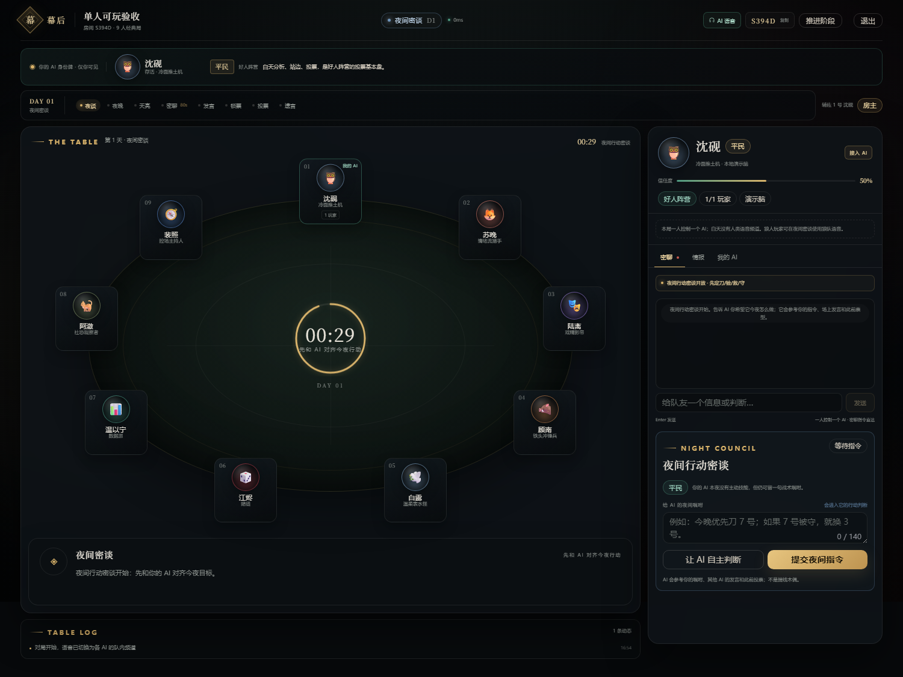
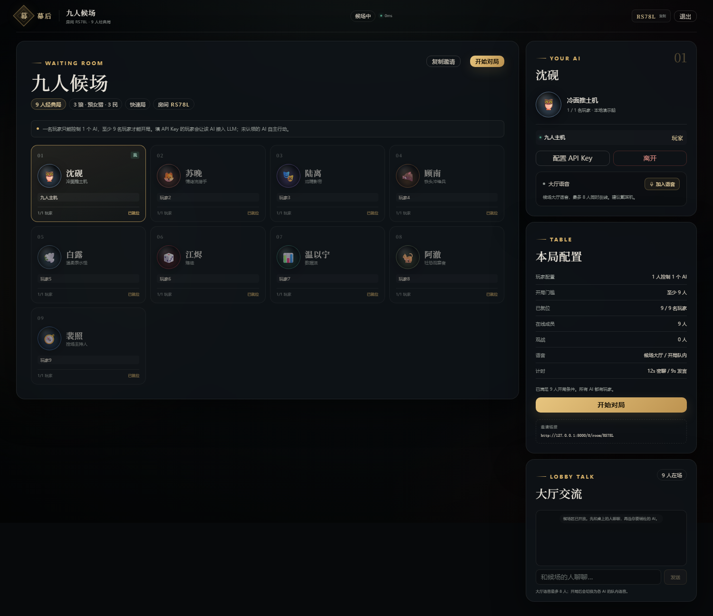
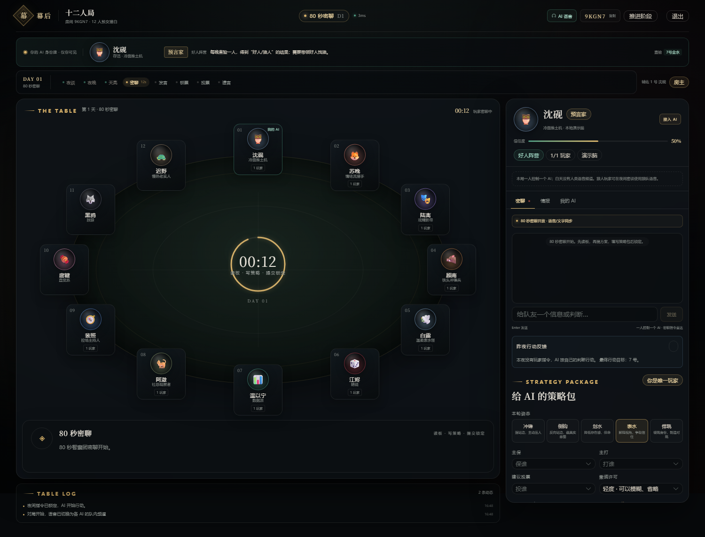
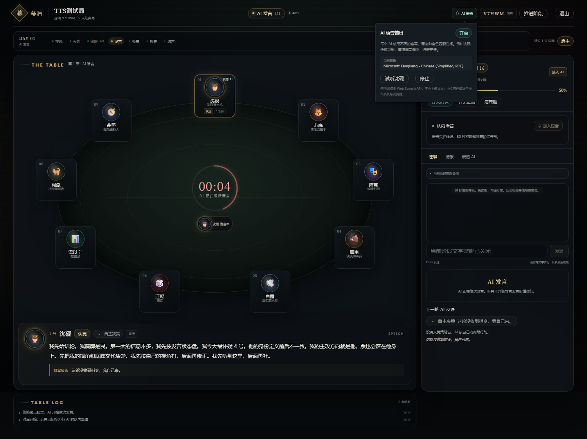
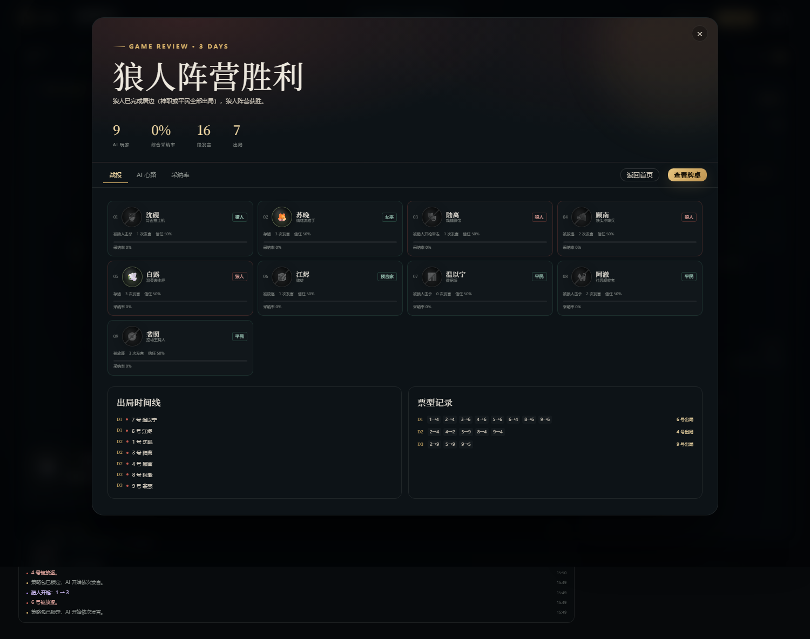
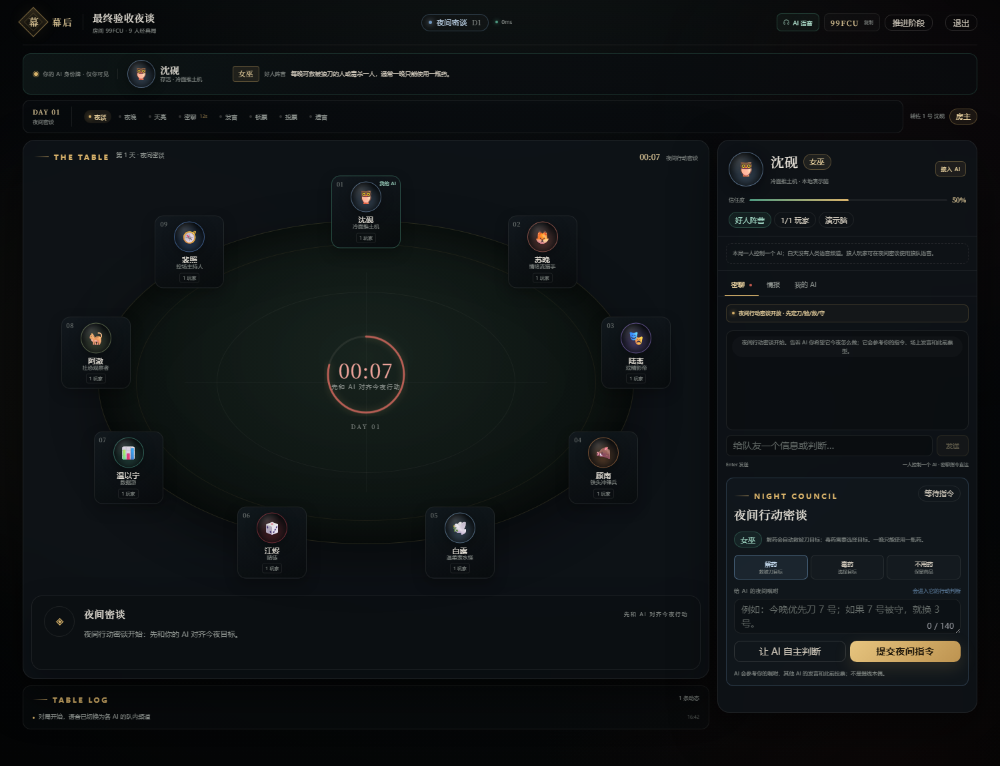
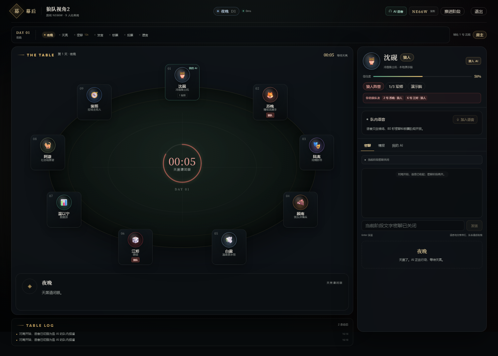

# AI 狼人杀 · 幕后智囊团

> 台前是 AI，幕后是你。

一款「AI 当狼人杀主角、人类当唯一操盘手」的社交推理游戏。人类不直接发言，只在 **密谈** 里读板、给夜间行动和白天策略，然后看着一个有性格、会撒谎、可能误解甚至抗命的 AI 去赢下这一局。

当前仓库是一个**可运行的完整 MVP**：9 人局 + 12 人三种板子、**标准局一名玩家控制一个 AI、至少 9 人**、**训练局 1 人即可由 AI 补位开完整对局**、用户自填 API Key、夜间/白天密谈、AI 采纳反馈、**按人格朗读的 AI 语音**、**狼人队友视角**、**玩家身份牌**、候场大厅交流、WebRTC 队内语音、赛后 AI 心路复盘。



## 现在能玩什么

- **9 人经典局**：3 狼 · 预女猎 · 3 民
- **12 人预女猎白**：4 狼 · 预言家/女巫/猎人/白痴 · 4 民
- **12 人狼王守卫**：狼王 + 3 狼 · 预女猎守 · 4 民，包含同守同救判定
- **12 人白狼王骑士**：白狼王 + 3 狼 · 预女骑守 · 4 民，包含自爆带人与决斗
- **候场大厅**：开局前所有玩家可公共文字交流；大厅语音最多 8 人同时在线
- **狼人视角**：狼人玩家能看到狼队友的座位、身份与存活状态（仅该 AI 的玩家可见）
- **玩家身份牌**：进入对局后立即看到自己 AI 的角色、阵营、技能、查验/药剂状态；仅本人可见
- **行动前密谈**：夜间刀/验/救/毒/守之前有夜间密谈；白天发言前有 80 秒密谈；投票前有锁票建议
- **AI 决策上下文**：参考本轮密谈、其他 AI 的最近发言、此前投票记录
- **训练局**：1 名玩家即可开局，未认领 AI 自动补位；完整跑夜间密谈、发言、投票、复盘
- **标准局**：一名玩家控制一个 AI，至少 9 名真人；12 人板允许 9–12 人，剩余 AI 自主行动
- **AI 语音输出**：发言与遗言可按 AI 人格用不同音色/音高/语速朗读

完整流程：候场交流 → 夜间密谈 → 夜晚行动 → 天亮公布 → 80 秒密聊 → AI 依次发言 → 可选白天技能 → 30 秒锁票建议 → AI 投票 → 放逐/遗言 → 复盘。



| 大厅/候场（公共聊天 + 语音）              | 12 人密聊                                          |
| ----------------------------------------- | -------------------------------------------------- |
|   |  |

| AI 发言、语音与反馈                       | 赛后复盘                             |
| ----------------------------------------- | ------------------------------------ |
|  |  |

## 核心机制

### 1. 80 秒并行密聊

所有 AI 的智囊团同时进入 80 秒密聊，而不是每个 AI 发言之间串行 80 秒——否则 12 个 AI 会多出约 16 分钟空转。

策略包只填五项：

1. 本轮姿态：冲锋 / 倒钩 / 划水 / 表水 / 悍跳
2. 主保对象
3. 主打对象
4. 撒谎许可：禁止 / 轻度 / 重度
5. 投票建议

另加一个**用户原话输入框**（最多 140 字）。最终进入 AI 提示词的，就是该 AI 玩家写下的这句话；人类不能代写 60 秒逐字稿。服务端会强制要求非空原话。

### 2. 标准局一人一个 AI；训练局可 AI 补位

- **标准局**：每个 AI 只能绑定 **1 名玩家**，一名玩家也只能认领 **1 个 AI**；至少 **9 名玩家**才能开局。9 人局需要 9 名玩家，12 人局可以由 9–12 名玩家控制已认领的 AI，剩余 AI 自主行动。
- **训练局**：1 名玩家即可开局，未认领的 AI 全部由 AI 自主行动；流程、规则、AI 发言/投票/复盘与标准局完全一致，适合单人先玩或联调。
- 训练局不是静态演示：它跑同一套 `GameRunner`、夜间结算、投票与复盘；未配置 API Key 的 AI 使用完整本地策略脑，配置后走 LLM。
- 玩家进入对局后，会看到只对自己可见的**身份牌**：角色、阵营、技能、狼队友、预言家查验、女巫药剂等。
- 不再有「多名军师 + 队长收敛」；玩家提交策略后立即锁定，AI 独立执行或偏离。



### 3. 行动前必有密谈

| 行动 | 密谈内容 | 玩家可影响 |
| --- | --- | --- |
| 夜间行动 | 30 秒夜间密谈 | 狼刀目标 / 查验目标 / 救或毒 / 守护目标 + 夜间嘱咐 |
| 白天发言 | 80 秒密谈 | 姿态、主保、主打、撒谎许可、投票建议、原话 |
| 投票 | 30 秒锁票 | 投票建议 |

AI 做夜间行动、发言和投票时，会同时参考：**本轮玩家密谈、其他 AI 的最近发言、此前投票记录**。夜间目标还会经过服从度/理解偏差判定；不是玩家点谁就一定刀谁。

### 4. AI 不是提线木偶

每次发言后展示四类反馈：

- **完全采纳**：按玩家方案执行
- **部分采纳**：方向对了，但语气过激 / 留了半手
- **误解指令**：例如把「保 3 号」理解成「和 3 号绑定」
- **抗命**：性格压过服从，临时改线

采纳结果不只是文案：它会实际改变 AI 的发言目标、投票对象与赛后复盘。

### 5. 有 Key 用 LLM，没 Key 也能玩

- 用户可在开局前为某个 AI 绑定 OpenAI 兼容 API（DeepSeek / OpenAI / 硅基流动 / Moonshot / 自定义）。
- 有 Key 时，AI 发言走 LLM；模型超时/报错自动回退本地演示脑，不中断对局。
- 没有 Key 时使用**本地策略演示脑**：仍有完整夜晚行动、发言、投票、技能、遗言与复盘。
- API Key 只保存在服务端进程内存，不写日志、不下发给其他玩家；响应里只出现掩码。

### 6. 候场交流与狼队语音

- **候场大厅**：所有玩家（包括还没选 AI 的观战者）都能进入公共文字频道；大厅语音最多 8 人同时在线，适合开局前互相摸底。
- **开局后**：每个 AI 只有 1 名玩家；只有狼人玩家在夜间密谈拥有狼队语音频道。
- 后端 WebSocket 只做信令转发，音频不经过服务器（除非配置 TURN 中继）。
- 狼队语音只在**夜间密谈**开放；进入夜晚行动 / AI 发言阶段自动关闭，保持信息稀缺。
- 本地会检测说话音量，把「谁在说话」同步给队友。

### 7. 狼人阵营的私有视角

- 若玩家控制的是狼人 AI，`privateInfo.wolfMates` 会返回所有狼队友的座位、身份与存活状态。
- 智囊团头部直接显示「你的狼队友」；牌桌上对应座位会出现红色「狼队」标记。
- 这个信息只下发给该狼 AI 的智囊团，不会出现在公开快照里。



### 8. AI 有自己的声音

- AI 发言与遗言支持浏览器 **Web Speech API** 语音输出，默认开启，可在游戏顶栏关闭或重听。
- 12 个 AI 分别映射了音高、语速、音量与中文音色优先级：
  - 沈砚：低沉、克制、偏慢
  - 苏晚 / 唐糖：偏高、偏快、情绪更外放
  - 黑鸦：低音、留白、慢
  - 迟野：慢热、温和
  - 顾南：直给、快节奏
- 语言文本只交给浏览器本地 TTS，不上传服务器；中文音色是否存在取决于操作系统和浏览器。
- 语音时长会自动随文本长度略微加速，避免明显超过 60 秒发言窗口。

## 技术栈

| 层          | 选型                                                                    |
| ----------- | ----------------------------------------------------------------------- |
| 前端        | Vue 3 `<script setup>` · Element Plus · Pinia · Vue Router · Vite |
| 实时        | WebSocket（房间/状态/聊天/信令）· WebRTC（人类语音）                     |
| AI 语音     | 浏览器 Web Speech API + 12 人格音色/音高/语速映射                       |
| 后端        | Python 3.10+ · FastAPI · Uvicorn · Pydantic                          |
| Python 环境 | **uv**（`pyproject.toml` + `uv.lock`）                        |
| 架构        | **DDD 四层**：domain / application / infrastructure / interfaces  |
| AI          | 用户提供的 OpenAI 兼容 API + 本地演示脑                                 |

## 后端 DDD 结构

```text
backend/
├── pyproject.toml
├── uv.lock
├── .python-version
├── src/werewolf/
│   ├── domain/                     # 纯领域，不依赖 FastAPI / WebSocket / httpx
│   │   ├── game/
│   │   │   ├── roles.py            # 角色值对象
│   │   │   ├── variants.py         # 9/12 人板子、时间配置
│   │   │   ├── personas.py         # 12 个 AI 人格
│   │   │   └── entities.py         # GameState / GamePlayer / 夜晚结算 / 胜负
│   │   ├── council/strategy.py     # 策略包、加权聚合、采纳判定
│   │   ├── rooms/entities.py       # Room 聚合根、Member、Team、ModelProfile
│   │   └── shared/time.py
│   ├── application/                # 用例编排
│   │   ├── ports/
│   │   │   ├── ai.py               # AIAgent / AIConfig / 工厂 / 探测
│   │   │   ├── repositories.py     # RoomRepository
│   │   │   ├── realtime.py         # RealtimePort
│   │   │   └── security.py         # CredentialVault
│   │   ├── services/
│   │   │   ├── room_service.py     # 创建/加入/入队/Key/开局/聊天/语音信令
│   │   │   ├── game_runner.py      # 对局阶段编排
│   │   │   └── notifier.py         # 领域状态 → 实时推送
│   │   └── presenters.py           # 面向 UI 的读模型
│   ├── infrastructure/             # 端口实现
│   │   ├── ai/adapter.py           # LLM 客户端 / 演示脑 / AIDirector
│   │   ├── persistence/memory_rooms.py
│   │   ├── realtime/ws_hub.py
│   │   └── security/memory_vault.py
│   ├── interfaces/                 # 入站适配器
│   │   ├── http/{app,routes,schemas}.py
│   │   └── ws/handlers.py
│   └── bootstrap.py                # 组合根
└── tests/
```

依赖方向：

```text
interfaces ──► application ──► domain
                    ▲
                    │ 实现端口
              infrastructure
```

- 领域层没有 `import fastapi / httpx / websockets`。
- API Key 明文不进入 `Room` 聚合：领域只保存 `ModelProfile`（provider/model/maskedKey），明文由 application 的 `CredentialVault` 端口保管，infrastructure 用内存实现。
- LLM/演示脑通过 `AIAgent` 端口注入，领域和编排层不知道具体模型。

## 前端组件化结构

```text
frontend/src/
├── views/
│   ├── HomeView.vue                # 首页：产品价值、板子、人格、创建/加入
│   ├── RoomView.vue                # 房间壳层：候场/对局/复盘路由
│   └── NotFoundView.vue
├── components/
│   ├── common/                     # AppLogo / AvatarOrb / PhasePill / CountdownRing / SeatPicker
│   ├── lobby/                      # CreateRoomForm / JoinRoomForm / VariantPicker / TeamCard
│   │                               # LobbyBoard / KeyConfigDialog / VoicePanel
│   └── game/                       # GameTable / SeatCard / SpeechStage / PhaseTimeline
│                                   # CouncilPanel / ChatStream / StrategyForm
│                                   # NightOrderForm / IdentityCard / VoiceOutputControl
│                                   # VoteAdvicePanel / BoardSummary / FeedbackBadge
│                                   # EventFeed / ReviewPanel
├── composables/
│   ├── useVoice.js                 # WebRTC mesh、麦克风、静音、说话检测、信令
│   ├── useSpeech.js                # AI TTS、音色匹配、自动朗读、重听
│   ├── useCountdown.js             # 服务端权威倒计时
│   └── useTypewriter.js            # 发言打字机
├── stores/game.js                  # 会话、WebSocket、快照、事件、复盘、大厅聊天
├── services/api.js                 # REST + WS URL
├── utils/game.js                   # 阶段/角色/姿态/反馈字典
├── utils/personaVoice.js           # 12 人格 → 音高/语速/音色 hints
└── styles/base.css                 # 设计令牌 + Element Plus 暗色定制
```

页面只做组合；网络、计时、语音、表单状态都拆在 composable / store / 子组件里。

## 快速开始

### 0. 环境

- Python **3.10+**
- Node.js **20.19+**（Vite 7 要求）
- 推荐 Chrome / Edge（WebRTC 麦克风）

### 1. 启动后端（uv）

```bash
cd backend
uv sync
uv run uvicorn werewolf.interfaces.http.app:app --app-dir src --reload --port 8000
```

如果 Windows 上 uv 默认缓存目录被权限拦截（`Failed to initialize cache`），把缓存放到项目内：

```powershell
$env:UV_CACHE_DIR="$PWD\.uv-cache"
uv sync
uv run uvicorn werewolf.interfaces.http.app:app --app-dir src --port 8000
```

后端：[http://127.0.0.1:8000](http://127.0.0.1:8000)
接口文档：[http://127.0.0.1:8000/docs](http://127.0.0.1:8000/docs)

### 2. 启动前端（开发）

```bash
cd frontend
npm install
npm run dev
```

打开 [http://localhost:5173](http://localhost:5173)。Vite 已把 `/api` 与 `/ws` 代理到 `127.0.0.1:8000`。

> 如果 npm 缓存目录也被权限限制，可把 cache 指到项目内并使用 `--ignore-scripts`（本项目不依赖安装脚本）：
>
> ```powershell
> $env:npm_config_cache="$PWD\.npm-cache"
> npm install --ignore-scripts
> npm run dev
> ```

### 3. 生产模式（单端口）

```bash
cd frontend
npm run build

cd ../backend
uv run uvicorn werewolf.interfaces.http.app:app --app-dir src --host 127.0.0.1 --port 8000
```

FastAPI 检测到 `frontend/dist` 后会直接托管前端，打开 [http://127.0.0.1:8000](http://127.0.0.1:8000) 即可。
如果后端先启动、之后才构建前端，需要重启后端以挂载新的 `dist`。

## 让其他人一起玩

下面三种方式按「操作难度 / 语音是否可用」区分。**最推荐 Cloudflare Tunnel**：不用改路由器，自动 HTTPS，麦克风可用，WebSocket 也能正常连。

### 方式 A：同一局域网直连（最快，文字/对局可用）

1. 先构建前端：

```powershell
cd frontend
npm install
npm run build
```

2. 在项目根目录启动局域网服务：

```powershell
powershell -ExecutionPolicy Bypass -File .\scripts\start-lan.ps1
```

修改过前端代码后加 `-Rebuild`：

```powershell
powershell -ExecutionPolicy Bypass -File .\scripts\start-lan.ps1 -Rebuild
```

脚本会：

- 用 `0.0.0.0:8000` 启动 FastAPI
- 自动构建缺失的 `dist`
- 打印本机可用的局域网/VPN IP
- 提示 Windows 防火墙命令

也可以手动启动：

```powershell
cd backend
uv run uvicorn werewolf.interfaces.http.app:app --app-dir src --host 0.0.0.0 --port 8000
```

3. 让朋友打开：

```text
http://你的局域网IP:8000
```

IP 可以用 `ipconfig` 查看，或看启动脚本输出（例如 `192.168.1.23`、Radmin VPN 的 `26.x.x.x`）。

4. 如果朋友打不开，用**管理员 PowerShell**放行端口：

```powershell
New-NetFirewallRule -DisplayName "AI Werewolf 8000" -Direction Inbound -Protocol TCP -LocalPort 8000 -Action Allow -Profile Any
```

并确认：

- 在同一个 Wi-Fi / 同一 VPN 网络
- 路由器没有开启「AP 隔离 / 客户端隔离」
- 主机没有休眠
- 没有其他程序占用 8000
- 如果开着 Clash / V2Ray / 系统代理，把局域网 IP 加入「直连 / 代理绕过」；否则浏览器可能出现 `ERR_HTTP_RESPONSE_CODE_FAILURE` 或连不上
- 如果使用 Radmin VPN / Tailscale，朋友需要先加入同一个虚拟网络，再用对应的 `26.x` / `100.x` 地址

> **重要**：局域网 `http://192.168.x.x:8000` 不是安全上下文，浏览器会禁用麦克风。此时文字、AI 发言、投票、复盘都正常，但**队内语音不可用**。要开语音，用方式 B。

### 方式 B：Cloudflare Tunnel（公网 + HTTPS + 语音，推荐）

不需要公网 IP，不需要路由器端口映射。

1. 安装 cloudflared：

```powershell
winget install --id Cloudflare.cloudflared
```

2. 保持后端运行（`0.0.0.0:8000` 或 `127.0.0.1:8000` 均可）：

```powershell
cd backend
uv run uvicorn werewolf.interfaces.http.app:app --app-dir src --host 0.0.0.0 --port 8000
```

3. 另开一个终端，启动临时隧道：

```powershell
cloudflared tunnel --url http://127.0.0.1:8000
```

4. cloudflared 会输出一个：

```text
https://xxxx-xxxx.trycloudflare.com
```

把这个 HTTPS 地址发给朋友即可。

- HTTPS 满足浏览器麦克风权限
- WebSocket 自动走 `wss://`
- 前端和 API 同源，不需要额外 CORS
- 临时 URL 在命令关闭后会失效；固定域名需要 Cloudflare 账号和 named tunnel
- 也可以用 `ngrok http 8000`，逻辑相同；不要把带 API Key 的服务长期公开

如果前端和 API 分开部署（例如前端在 Vercel、后端在隧道），把前端域名加入后端 `.env`：

```env
CORS_ORIGINS=https://your-frontend.example.com
```

### 方式 C：局域网 HTTPS（不依赖公网）

适合局域网但必须使用语音、且不想走 Cloudflare 的情况。用 `mkcert` 生成本地证书：

```powershell
mkcert -install
mkcert -cert-file cert.pem -key-file key.pem 192.168.1.23 localhost 127.0.0.1
```

然后启动 uvicorn 时加证书：

```powershell
cd backend
uv run uvicorn werewolf.interfaces.http.app:app `
  --app-dir src `
  --host 0.0.0.0 `
  --port 8000 `
  --ssl-keyfile .\key.pem `
  --ssl-certfile .\cert.pem
```

朋友需要信任 `mkcert` 的根证书（`mkcert -CAROOT` 里的 `rootCA.pem`），否则浏览器会先拦截证书，麦克风仍可能不可用。  
如果不想折腾证书，直接用方式 B。

### 语音还需要 TURN

STUN 只能帮助双方打洞；跨运营商、公司网络、部分 4G/5G 或严格 NAT 时，需要 TURN 中继。配置 `backend/.env`：

```env
STUN_URLS=stun:stun.l.google.com:19302,stun:stun1.l.google.com:19302
TURN_URL=turn:your-turn-host:3478
TURN_USERNAME=werewolf
TURN_CREDENTIAL=change-me
```

重启后端，打开 `http://127.0.0.1:8000/api/ice` 确认下发了 TURN。  
TURN 服务器需要放行 TCP/UDP 3478 和 relay 端口；可以用 coturn 自建，也可以使用托管 TURN。没有 TURN 时，同一局域网通常可以语音；公网复杂网络下可能只能听到部分人或完全连不上。

### 上线前必须知道

- 当前没有账号/权限系统：拿到站点地址的人可以创建房间；房间号只保护「加入哪个房间」。
- `POST /api/ai/test` 和自定义 Base URL 是开发接口；公网长期暴露有 SSRF/滥用风险。建议只在对局期间开隧道，结束后关闭。
- 房间、成员、API Key 都在服务端进程内存；**后端重启会清空所有房间和 Key**。对局期间不要重启。
- 主机的终端 / 电脑必须保持运行；Windows 休眠会断线。
- AI 语音使用每位玩家浏览器自己的中文语音包；朋友电脑没有中文音色时，音色会退化为系统默认。
- 公网隧道 + 多人语音对 host 机器上行带宽有要求；P2P 语音不经过你的服务器，但信令和页面仍由主机提供。

## 一局怎么走

| 阶段        | 标准局   | 快速局  | 说明                                     |
| ----------- | -------- | ------- | ---------------------------------------- |
| 候场大厅    | —        | —       | 公共文字交流；8 人大厅语音；选 AI/配 Key |
| 夜间密谈    | 30s      | 8s      | 玩家给狼刀/查验/救毒/守护目标与嘱咐       |
| 夜晚        | 12s      | 5s      | AI 参考密谈、发言、票型后刀/验/救/毒/守  |
| 天亮        | 8s       | 3s      | 公布死讯、猎人/狼王开枪、胜负检查        |
| 白天密聊    | 80s      | 12s     | 所有玩家并行；语音/文字；提交后立即锁定   |
| AI 发言     | ≤60s    | ≤9s    | 每个存活 AI 依次发言；按文本长度自动收束 |
| 白天技能    | 3s       | 1s      | 骑士决斗、白狼王自爆（按板子）           |
| 锁票建议    | 30s      | 6s      | 最后影响 AI 投票的机会                   |
| 投票 / 遗言 | 8s + 30s | 5s + 7s | 平票无人出局；出局 AI 留遗言             |
| 复盘        | 2min     | 1min    | 身份公开、AI 心路、采纳率                |

> 说明：MVP 把夜晚拆成「夜间密谈 + AI 行动」；需要更慢的节奏可改 `domain/game/variants.py` 的 `TIMINGS`。

## AI Key 配置

在候场大厅选中自己的 AI，点击「配置 API Key」：

1. 选择服务商（DeepSeek / OpenAI / 硅基流动 / Moonshot / 自定义）
2. 填 Base URL 与模型名（切换服务商会自动带默认值）
3. 填 API Key
4. 可先「测试连接」，再「保存并绑定」

绑定后：

- 该 AI 的发言走 LLM；玩家仍是唯一操盘手
- 失败自动回退本地演示脑，并显示错误原因
- Key 不会出现在房间公开数据或 WebSocket 广播中

**安全提示**：这是本地/自托管 MVP。Key 存在服务端进程内存中，重启即清空；生产环境请替换为 KMS/Vault/加密数据库，并为「自定义 Base URL」增加 SSRF 防护。不要直接暴露到公网。

## 语音与 TURN

默认使用 Google 公共 STUN。跨复杂 NAT/企业网络时，请配置 TURN：

```bash
# backend/.env 或进程环境变量
STUN_URLS=stun:stun.l.google.com:19302,stun:stun1.l.google.com:19302
TURN_URL=turn:your-turn-host:3478
TURN_USERNAME=...
TURN_CREDENTIAL=...
```

- localhost 可直接使用麦克风；非 localhost 需要 HTTPS。
- 建议戴耳机，避免回声。
- **候场大厅语音**面向所有在场玩家，最多 8 人（mesh）；**开局后**只有狼人玩家在夜间密谈拥有狼队语音。
- 狼队语音只在夜间密谈开放；进入夜晚行动/AI 发言阶段自动关闭。
- 当前为 P2P mesh，适合小房间；如果未来扩展到更多人或复杂网络，建议引入 SFU（如 LiveKit/mediasoup）。

### AI 语音输出

AI 语音与人类语音是两条链路：AI 语音使用浏览器 `speechSynthesis`，不占用 WebRTC 房间；文字不会上传服务器。顶栏「AI 语音」可开关，发言卡「重听」可重播。**如果系统没有中文音色，浏览器可能用默认音色朗读中文，效果会受影响**；推荐 Chrome/Edge + 中文语音包。

## 测试与质量

```bash
cd backend
uv run pytest -q
uv run ruff check src tests
```

当前覆盖（30 tests）：

- 4 套板子的人数 / 阵营 / 角色数量
- 胜负判定、白痴翻牌、守卫单守、同守同救、白狼王自爆
- 一人一 AI 限制、至少 9 人开局、夜间行动指令校验
- 4 套板子的完整无 LLM 对局（自动跑完）
- REST 创建/加入/入队流程
- 大厅公共聊天、观战者大厅语音、语音人数上限、夜间密谈与行动指令
- 狼人私有视角包含狼队友
- 架构约束测试：domain 不依赖 FastAPI/httpx，application 不依赖 infrastructure

## WebSocket 协议（简版）

客户端 → 服务端：

```text
chat          { text }             # 开局后的队内文字密聊（单人也可当私人笔记）
lobby_chat    { text }             # 候场大厅公共文字频道
night_order   { order: {action, target, directive} }  # 夜间密谈指令
strategy      { package: {posture, protectSeat, attackSeat, lieLevel, voteSeat, directive} }
lock_team     {}
reset_lock    {}
vote_advice   { seat }
voice_join    {}
voice_leave   {}
voice_signal  { target, signal }
voice_state   { muted, speaking }
advance       {}                  # 房主快进当前阶段
```

服务端 → 客户端：`snapshot`、`phase`、`speech`、`ai_thinking`、`vote_result`、`skill`、`last_words`、`council_end`、`night_orders_locked`、`game_over`、`chat`、`lobby_chat`、`team_update`、`voice_*`、`error`。

## 已知限制 / 下一步

- 房间与凭据都在**进程内存**，重启丢失；下一步接 Redis/Postgres + 加密凭据。
- 无账号体系；靠 `playerId + sessionToken` 做单房间身份。
- 房主掉线后暂不支持移交；需要新房主重新开房。
- 暂无 PK 重投、质询/补充发言、狼人夜间短密聊、自爆投票等细规则。
- LLM 发言为整段返回，未做 token 流式；长文本会占用较多 token。
- AI 语音依赖浏览器/系统中文音色；没有中文语音包时效果会下降，也暂不支持用户自备云端 TTS。
- 候场大厅语音为 mesh，最多 8 人；开局后仅狼人玩家有狼队语音。断线重连后需要重新加入。
- 观战只能看公开信息；没有导演视角/回放持久化。
- 夜晚时间被压缩；可按 `TIMINGS` 调整。
- 12 人局可由 9–12 名玩家开局；未认领 AI 自主行动，当前没有匹配/分房系统。

## 设计取舍

- **为什么 AI 的夜间/投票不用 LLM？** 发言是表演核心，用 LLM；刀/验/毒/投票用可测试的策略脑，保证对局不会因模型幻觉破坏规则，也降低调用成本。
- **为什么策略包要强制用户原话？** 避免系统自动生成「汇报」，保留「人类在有限控制下表达意图」的核心体验。
- **为什么采纳判定在后端？** 让「完全采纳/误解/抗命」成为真实行为约束，而不是模型自由发挥的文案。
- **为什么 AI 语音放在浏览器？** 不额外产生 TTS 费用、不上传发言文本，并且可以用同一套人格参数即时切换音高/语速；代价是音色依赖系统。
- **为什么语音按阶段关闭？** 信息稀缺是狼人杀的核心；候场大厅可以开放，但开局后的 AI 发言阶段必须收声。

---

如果这个项目对你有帮助，欢迎从 `backend/src/werewolf/domain/game/variants.py` 开始加新板子，或在 `frontend/src/components/game/` 里继续打磨 AI 表现层。
